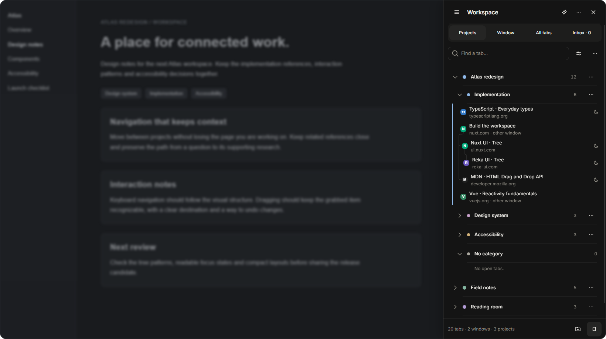
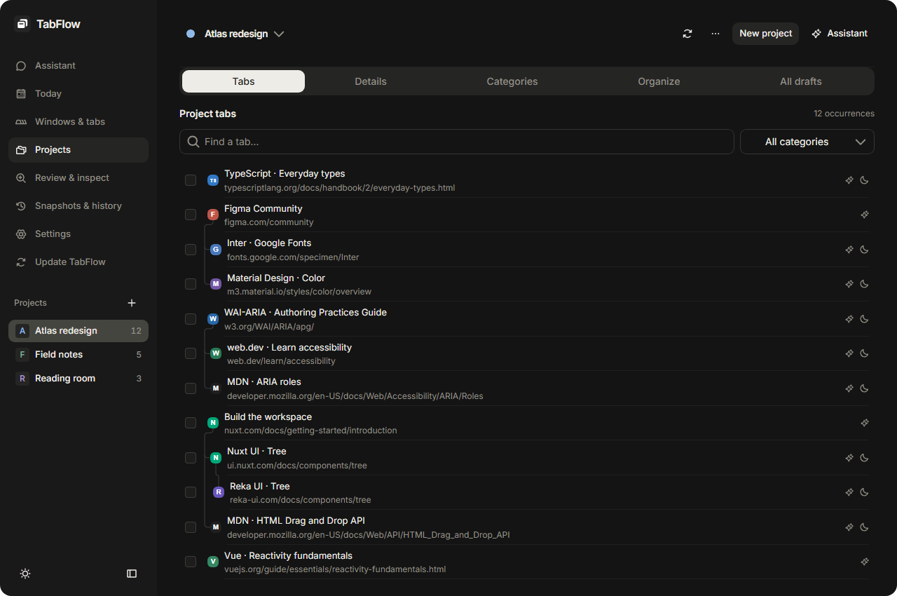

<div align="center">
  
  <h1>TabFlow</h1>
  <p>Projects, saved sessions and suspension for your browser tabs.</p>
</div>

<p align="center">
  <a href="#install">Install</a> |
  <a href="#features">Features</a> |
  <a href="#guides">Guides</a> |
  <a href="#development">Development</a>
</p>

TabFlow is a Manifest V3 extension for Chromium-based browsers. Manage large tab collections across windows from a side panel: organize projects, keep related pages together, and save a session to return to later.



## Features

- **Project workspaces.** Organize tabs into projects and categories independently of browser windows and native groups.
- **Connected research.** Keep related pages in named, collapsible branches with up to five levels. Reorder tabs, categories and projects with drag-and-drop.
- **Search and tags.** Find tabs across windows by title, address, notes, tags and available cached page text.
- **Saved sessions.** Save snapshots, resume missing tabs, review changes and export portable backups.
- **Tab suspension.** Reduce memory use by keeping inactive tabs in lightweight placeholders with their original addresses preserved. Configure automatic suspension and site exceptions.
- **Optional AI assistance.** Ask about selected tabs, generate organization drafts, suggest tags and edit the workspace through an OpenAI-compatible endpoint.



## Install

TabFlow currently loads as an unpacked extension. It requires a Chromium-based browser with side-panel support, version 121 or newer.

1. Download the extension ZIP from [Releases](https://github.com/b1ink0/tabflow/releases/latest) and extract it to a permanent folder.
2. Open the browser's extension-management page (`chrome://extensions`) and enable **Developer mode**.
3. Select **Load unpacked** and choose the extracted folder containing `manifest.json`.
4. Pin TabFlow and select its toolbar icon to open the side panel. **Ctrl+Shift+Y** opens the full workspace when available.

## Guides

- [Tab management, sessions and suspension](docs/workflows.md)
- [AI assistance and organization drafts](docs/assistant.md)
- [Settings and troubleshooting](docs/configuration.md)
- [Data storage and sharing](docs/privacy.md)

Workspace data is stored in the extension. AI features send selected context to the configured model endpoint. Attached images require an image-capable model.

## Development

Requires Node.js 22 or newer and Bun 1.4.2 or newer.

```sh
bun install --frozen-lockfile
bun run build
```

Load `.output/chrome-mv3` as an unpacked extension. `bun run dev` starts the WXT development build.

See [contributing](docs/contributing.md) for checks and screenshot generation, [architecture](docs/architecture.md) for the system overview, and [design system](docs/design-system.md) for interface principles.

## License

[MIT](LICENSE)
