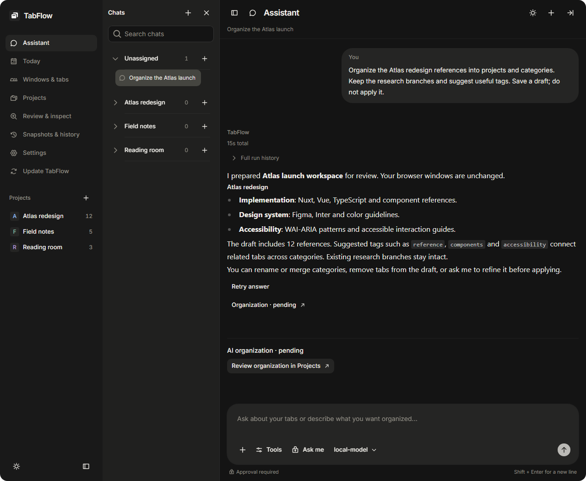
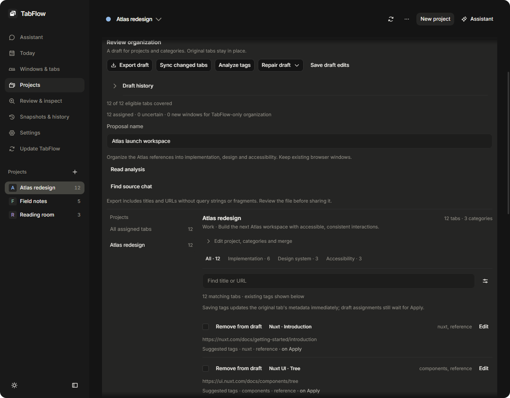

# AI assistance

AI is optional. TabFlow connects to an OpenAI-compatible endpoint configured in Settings. See [model configuration](configuration.md) for endpoint and model settings.

## Context and conversation

The composer's + menu attaches images or workspace objects: tabs, windows, projects, categories, tags and proposals. Attachments capture the included tabs when sending. Follow-up questions can use that saved context, while explicit new selections define a new scope.

The assistant can search existing tabs, compare references, suggest related open pages, prepare metadata edits and propose browser operations. It has no web-search tool. Tools controls the available operation modes and scope.

## Organization drafts

Analysis proposes projects, categories, assignments and optional tags. Large collections use bounded batches with saved progress. Retry or Resume retains compatible completed stages. Additional page inspection is separate from analysis of saved metadata.

A draft can be renamed, refined, copied or merged with another draft. Projects/categories and assignments remain editable. Unwanted tabs can be removed from the draft without closing their browser pages. Tag suggestions remain independent of project/category choices.

Review organization opens the draft. Apply organization saves its assignments and proposed tags. Creating native project windows is a separate copy operation. Saving or refining a draft does not apply it.

Tag generation has a per-request budget, while saved records and merged drafts retain their complete tag sets. Uncertain suggestions remain reviewable. Analyze tags and Repair tags only update tag analysis independently of project/category classification.

## Actions and approval

Prepared actions show their targets and affected counts. The approval control offers:

- **Ask me:** each prepared action requires manual approval.
- **Approve for me:** the configured model reviews the exact action against the request and asks when it cannot decide.
- **Approve all:** skips application approval prompts and model review for that chat.

Browser permissions and target protections apply in every mode. A changed action or draft revision requires fresh validation. Opening an old chat does not replay its saved actions.

Supported mutations provide Undo/Redo and before/after history. Undo retains later independent edits. Page visits and network requests cannot be undone. Retry answer preserves prior conversation branches and action receipts.

## External classification

Classify externally exports a bounded organization input for use with another assistant. Import draft validates the returned data for review. The imported draft follows the same editing and application flow. It does not execute browser actions merely by being imported.
