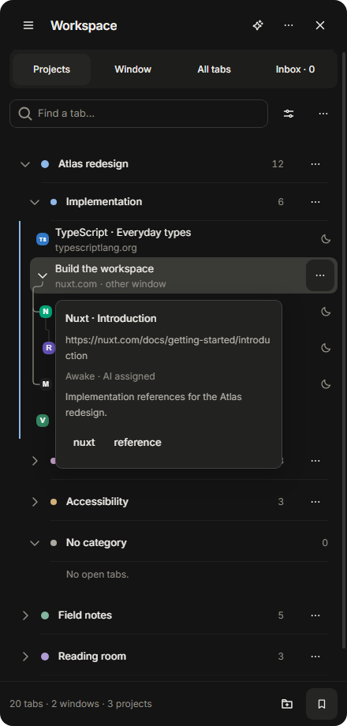
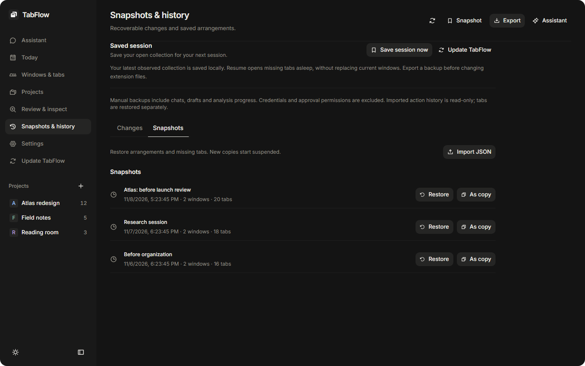

# Tab management

## Workspace views

The side panel provides Projects, Window, All tabs and Inbox views. Select a tab to focus it in the browser. Projects contain categories and can span several windows. Assigning a project does not change native placement.

Search matches titles, original addresses, notes and available cached text. Filters combine projects, categories, windows, native groups and tags. Any/All tag matching and an untagged filter are available. Saved views retain filter settings.

Right-click a row for browser and organization actions. New tab below and Duplicate retain the source project, category and sibling branch. Copy clean link removes recognized tracking parameters. Selecting multiple tabs exposes batch actions.

## Projects, categories and branches

Projects and categories have names, colors and a saved display order. Categories and tags can be managed in Settings. Moving a category transfers its memberships to the destination project. Deleting a category leaves its tabs uncategorized. It does not close them.

Nested tabs retain parent/child relationships up to five levels. A named branch labels the parent without renaming the webpage. Tab branch actions can nest, detach or name a branch. Dragging a row's center nests beneath it. Its edges insert beside it. Moving a subtree into another project/category moves its memberships together. Undo/Redo is available for supported changes.

Project layout switches between a vertical tree and a horizontal project strip. Expansion and display order are retained. Follow browser tab changes reveals the active tab unless a search, selection or dialog is in progress. Reveal current tab offers explicit navigation.

Tags connect tabs across categories and projects. A tab's detail card contains its tags and note. Selecting a tag opens the matching workspace filter.

## Suspension and inspection

Automatic suspension starts disabled. Settings controls inactivity timing, protected tab types and site exceptions. Sleeping placeholders retain original addresses, titles and icons. Wake restores the page. Inspection can gather missing page context with authorized host access.

Bulk waking uses a queue with progress and Pause/Resume. Pages load one at a time. A page that remains loading pauses the queue rather than starting more pages. Interrupted work requires explicit resumption.

## Sessions, snapshots and backups

Save a snapshot to retain a recovery point. Snapshots & history lists saved states and changes. Restoring retains unrelated tabs and pages that have independently navigated.

When the saved session differs from the current browser, the workspace bar offers Keep and Resume. Keep accepts the current tabs and dismisses missing-tab recovery while retaining the earlier source in Snapshots. Resume restores missing tabs.

Snapshot retention defaults to 150 and is configurable. Active recovery points remain protected. Export a portable backup before changing installations or resetting data. Manual exports include saved workspace and assistant data. Cached page text, preview images, credentials and executable approvals are excluded.

Settings / Data management supports selective cleanup and a complete local reset. Deletion leaves browser tabs open and is not undoable.

## Migration and updates

Review & inspect can recover recognized placeholders from another suspender. Keep the old extension installed until original addresses have been recovered and verified. Recovery progress and receipts identify failed or skipped entries.

For an unpacked update, replace production files in the loaded folder, then use Update TabFlow / Save & reload. Retain a backup and follow visible recovery progress if interrupted. Removing the extension also removes its local storage.

## Browser menus

Where supported, TabFlow adds context-menu actions to reveal, organize, protect, suspend or ask about tabs. Page/link actions include finding an address in the workspace. Available menu contexts depend on browser capabilities.
